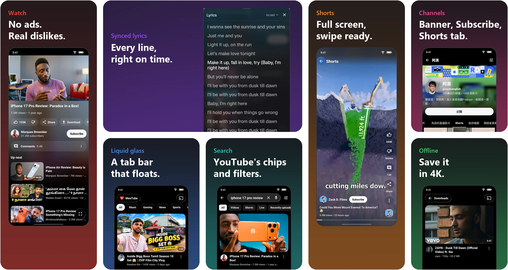

<p align="center"></p>

<h1 align="center">MeeTube</h1>

**YouTube, reimagined. Different by design. Smooth by nature.** <br><br> No ads. No interruptions. Just a gorgeous liquid glass interface, synced lyrics, background playback, and one-tap downloads.<br><br> **A fresh way to experience YouTube.**<br><br>

<p align="center"></p>

<p align="center"><a href="https://github.com/yashoncode/meetube/releases/latest"><b>⬇ Download the latest MeeTube</b></a></p>

<p align="center">
<a href="https://github.com/yashoncode/meetube/releases/latest"></a>
<a href="LICENSE"></a>
<a href="https://github.com/yashoncode/meetube/releases"></a>
</p>

> [!IMPORTANT]
> MeeTube is not affiliated with, endorsed by, or connected to YouTube or Google in any way. Use it at your own discretion.

## Features

<table>
<tr>
<td width="50%" valign="top">🚫 <b>No ads, no sponsors</b><br>Ads are gone, and SponsorBlock skips sponsors, intros and "like and subscribe" reminders.</td>
<td width="50%" valign="top">💎 <b>Liquid glass</b><br>Frosted, lens-bending glass on the tab bar, the player and Shorts, lit by GlowFlow: a glow that follows your tab, your progress and live channels.</td>
</tr>
<tr>
<td valign="top">🎤 <b>Synced lyrics</b><br>Music videos get live, line-by-line lyrics. Pick your lyrics provider in one tap.</td>
<td valign="top">🎧 <b>Background play and picture-in-picture</b><br>Lock the screen or switch apps and it keeps playing. Shorts float in their own portrait window.</td>
</tr>
<tr>
<td valign="top">⬇️ <b>Offline downloads</b><br>Save videos up to 4K for a flight, a train or a day without data, in any folder you pick.</td>
<td valign="top">📱 <b>Shorts done right</b><br>A clean full-screen player with glass like, comment and share buttons.</td>
</tr>
<tr>
<td valign="top">🧑‍🎤 <b>Channels at a glance</b><br>Every card shows the channel's photo; tap it to open the channel with its banner, Subscribe button and Shorts tab.</td>
<td valign="top">🔎 <b>YouTube's search filters</b><br>One-tap chips for Videos, Shorts, Live and Recently uploaded, plus the full filter dialog.</td>
</tr>
<tr>
<td valign="top">👎 <b>Dislikes are back</b><br>Return YouTube Dislike shows the real count, and DeArrow swaps clickbait titles and thumbnails.</td>
<td valign="top">💬 <b>Smooth comments and fullscreen</b><br>A glass comment bar that rises with the keyboard, and vertical videos go fullscreen upright.</td>
</tr>
<tr>
<td valign="top">🎨 <b>Make it yours</b><br>Theme, app icon, glass, Home layout, tabs, double-tap skip time and the video menu, all on one page.</td>
<td valign="top">🔄 <b>Always something new</b><br>Pull Home to refresh and get videos you haven't seen yet.</td>
</tr>
<tr>
<td valign="top">🌏 <b>Speaks your language</b><br>English, Español, Română, Русский, 简体中文 and 繁體中文. Channel pages, view counts and dates follow your language too. <a href="TRANSLATING.md">Help translate</a>.</td>
<td valign="top">🔐 <b>Your account, your subscriptions</b><br>Sign in with a code, or use it without an account. Cast to your TV.</td>
</tr>
</table>

## Download

Get the APK for your phone from [Releases](https://github.com/yashoncode/meetube/releases/latest):

> **Coming from MeTube?** MeTube is now MeeTube, with a new app id, so it installs as a separate app. Install MeeTube, then uninstall the old MeTube.

| Your device | File |
|:--|:--|
| Most phones (64-bit) | `MeeTube_<version>_arm64-v8a.apk` |
| Older phones (32-bit) | `MeeTube_<version>_armeabi-v7a.apk` |
| Not sure | `MeeTube_<version>_universal.apk` |

Android 7.0 or later.

Every release is built and signed in public by [GitHub Actions](https://github.com/yashoncode/meetube/actions/workflows/release.yml) from this repository's source, so you can see exactly how each APK was made.

## MeeTube and NewTube

MeeTube is a heavily tweaked fork of [NewTube](https://github.com/aleixrodriala/newtube) by [@aleixrodriala](https://github.com/aleixrodriala), and NewTube is built on [SmartTube](https://github.com/yuliskov/SmartTube) by [@yuliskov](https://github.com/yuliskov). MeeTube follows NewTube's playback and network fixes, and adds its own design and features on top: lyrics, liquid glass, the Shorts player, channel photos, search chips and the rest of the list above. Beyond what you see:

- **Its own app.** A separate app id (`io.yash.meetube`), so it installs alongside NewTube or SmartTube, and an in-app updater that follows MeeTube's releases.
- **True black.** The dark theme is AMOLED black by default, with a red accent and rounded thumbnails. A light theme is in Settings.
- **Quicker Shorts.** The next Short is fetched and buffered while you watch the current one, so a swipe starts playing right away.
- **Lighter on memory.** Video buffers are sized to your phone's memory, so long sessions don't run out of it.

MeeTube is an independent project and is not endorsed by either upstream developer.

## Build

```
./gradlew :smarttubetv:assembleStmobileDebug     # debug, for testing
./gradlew :smarttubetv:assembleStmobileRelease   # release, signed with keystore.properties if present
# APKs: smarttubetv/build/outputs/renamed_apks/stmobile<Type>/MeeTube_<version>_<abi>.apk
```

Releases are made by pushing a `vX.Y.Z` tag: [release.yml](.github/workflows/release.yml) builds the signed APKs and publishes the GitHub release with its changelog. The glass is `smarttubetv/src/stmobile/java/com/newtube/mobile/ui/common/GlassView.java`; the README showcase comes from `python tools/render_showcase.py`. Clone with `--recurse-submodules`. The backend lives in the `MediaServiceCore` and `SharedModules` submodules (NewTube's forks). Add `-PemulatorAbi` to run on an x86_64 emulator. For upstream documentation, see [NewTube's README](https://github.com/aleixrodriala/newtube#readme) and [CLAUDE.md](CLAUDE.md).

## Support MeeTube

MeeTube is free, has no ads and always will. I build it in my spare time because I love using it.
If it makes your YouTube a little nicer and you'd like to say thanks, you can buy me a coffee.
It's completely optional, and every coffee is truly appreciated. ☕

<p align="center"><a href="https://buymeacoffee.com/yashwynth"></a></p>

A star on GitHub or sharing MeeTube with a friend helps just as much. Thank you for using it! ❤️

## License

MIT, see [LICENSE](LICENSE). The original NewTube and SmartTube copyright notices are kept. See [THIRD_PARTY_NOTICES.md](THIRD_PARTY_NOTICES.md).
